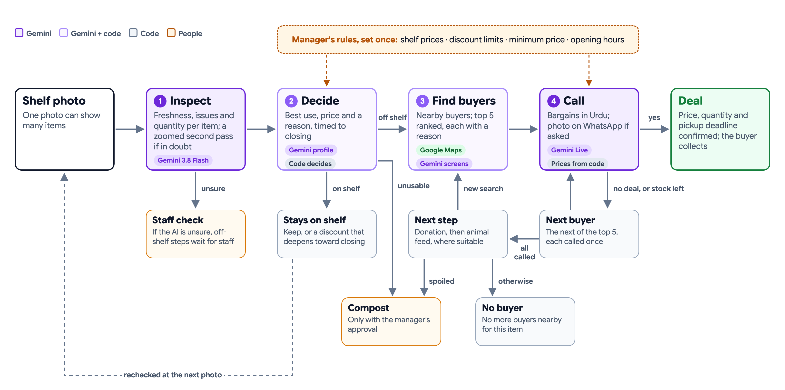
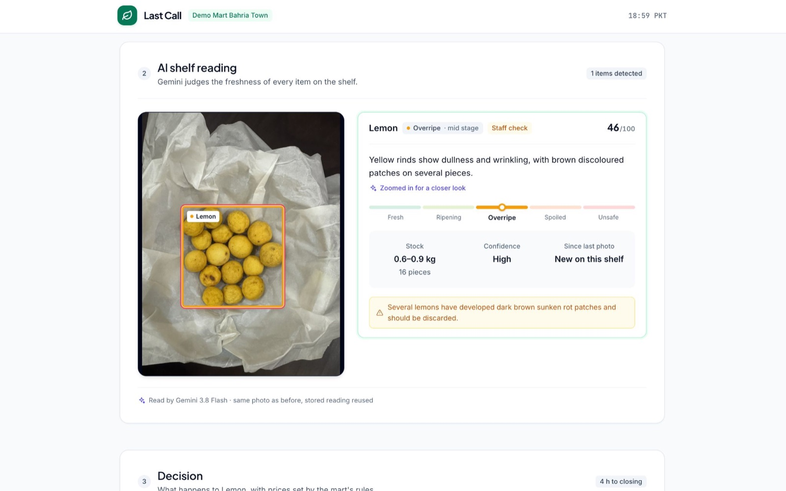
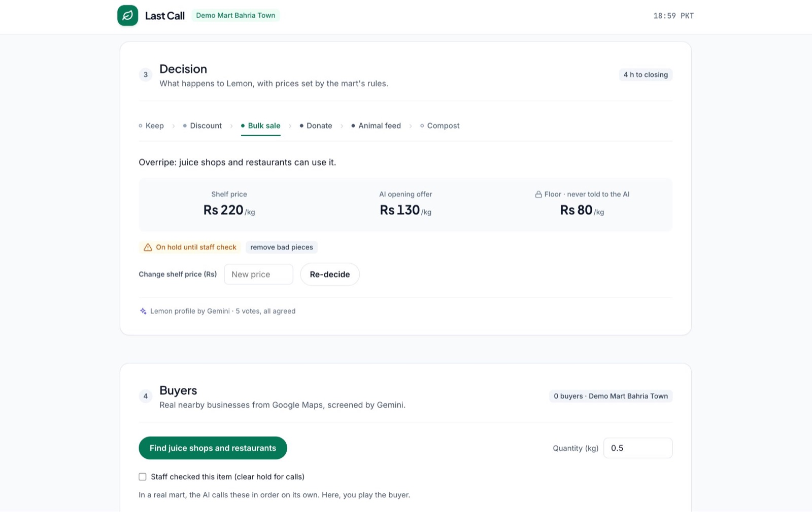
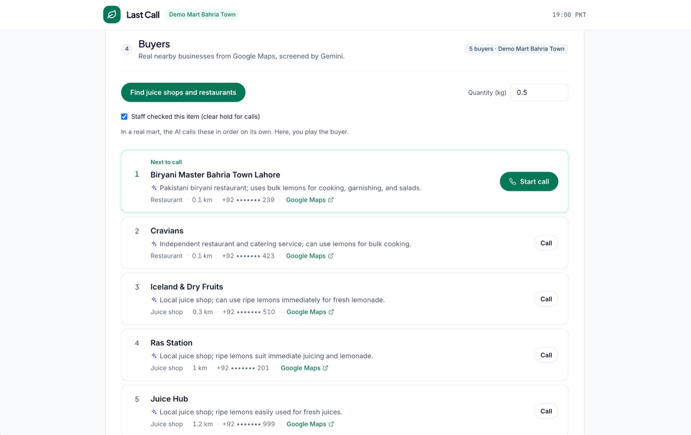
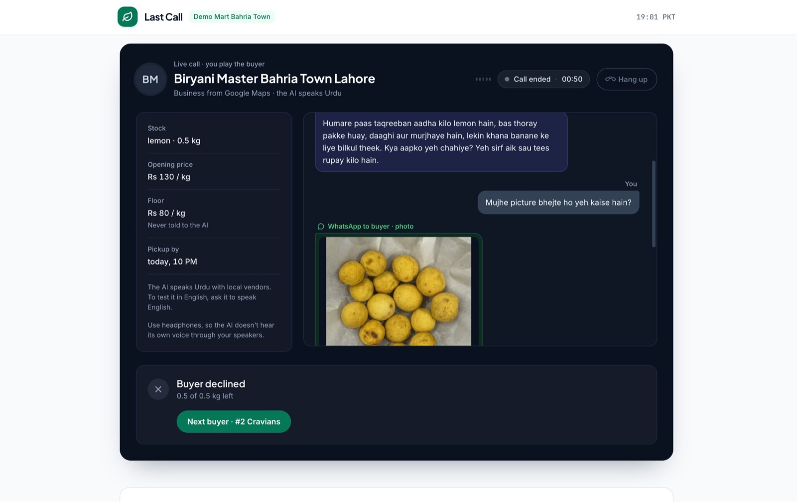
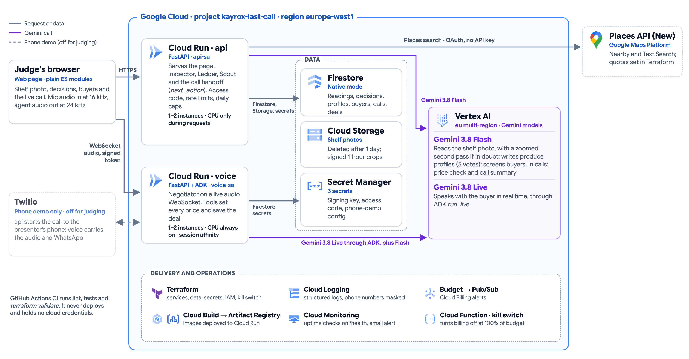
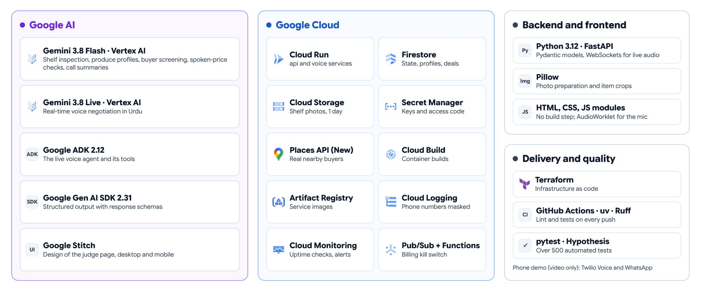

# Last Call

[](https://github.com/kashmal-rahat/last-call/actions/workflows/ci.yml)
[](https://github.com/kashmal-rahat/last-call/actions/workflows/terraform.yml)

**An AI that sells a grocery mart's near-expiry produce, by phone, in Urdu.**

Every evening Pakistani marts throw away fruit and vegetables that local juice shops, bakeries,
charities and dairy farms would happily take. Last Call reads the shelf from a photo, decides
what each item should become (discount, bulk sale, donation, animal feed or compost) and at what
price, finds nearby buyers on Google Maps, and calls them in Urdu to negotiate and close the deal.

Built by team Kayrox for the Google Cloud AI Builder Cup 2026 (Retail & Commerce: Intelligent
Customer and Business Experiences).

**Demo video (3 minutes):** https://youtu.be/Z1CFfsC7fr8

**Live demo:** deployed on Cloud Run, where you play the buyer in a real voice conversation with the
AI in the browser. It is behind an access code; judging has ended and the code has been changed, so
open an issue on this repo if you would like to try it. The services scale to zero when idle, so the first page load
takes a few seconds.



## Why Last Call

**Most tools are passive; Last Call is active.** Pricing systems discount for shoppers already in
the store, and surplus-food apps and marketplaces sell only to buyers who come to them. The
buyers who would take this produce (juice shops, bakeries, dairy farms) are too busy to check
discount apps and mostly trade over the phone, and mart staff have no time to call around. Last
Call goes out, finds them and closes the deal on a call, in their own language.

**An AI that sells for the mart, not just advises it:**

- **It can't undersell you.** The AI never sees the minimum price, code sets every counter-offer,
  and a deal is saved only after the buyer confirms every term (price, quantity, pickup, payment).
- **It can't send food the wrong way.** Spoiled food never goes to people, and mouldy food never
  goes to animals, enforced in code.
- **It never acts on doubt.** An unclear reading waits for a staff check, and nothing goes to
  compost without the manager's approval.
- **It works for any produce from day one,** with no product catalogue to build: Gemini writes a
  profile the first time it sees a produce.
- **The manager sets the rules once** (shelf prices, discount limits, minimum price, opening
  hours), and the AI does the rest.

**Who gains:** the mart recovers revenue from stock it would have written off, with no staff time
spent on calls; local businesses buy produce at a discount; and less goes to landfill.

## Screenshots

| | |
|---|---|
|  |  |
| **Shelf reading:** Gemini judges freshness, zooms in on doubtful items and flags a staff check | **Decision:** the best use and the prices, from the mart's rules; the floor is never told to the AI |
|  |  |
| **Buyers:** real nearby businesses from Google Maps, screened and ranked by Gemini, phones masked | **Live call:** you play the buyer; the AI bargains in Urdu and sends a photo of the item |

## How it works

Four agents, each with one job. Throughout, **Gemini judges and code decides**: the model reads,
understands and talks; deterministic code computes scores, prices and limits, and enforces them.

| Agent | Gemini's part | Code's part |
|---|---|---|
| **Inspector** (`services/api/lastcall_api/inspector`) | Gemini 3.8 Flash reads the shelf photo, then zooms into doubtful groups (two passes) and describes ripeness, damage and quantity | Computes the 0–100 freshness score, matches items to the previous photo, flags items for a staff check, caches readings |
| **Ladder** (`ladder`) | Writes a profile per produce type (how long each ripeness stage sells, which buyers can use it), agreed by 5 votes and cached | Picks keep / discount / bulk sale / donate / animal feed / compost, the discount and the opening and floor prices, from the hours left until closing |
| **Scout** (`scout`) | Screens each nearby business: is it likely to buy this produce? | Searches Google Places by buyer type, filters (distance, phone, do-not-call, duplicates), ranks, and keeps the top 5 |
| **Negotiator** (`services/voice`) | Gemini Live speaks Urdu on the call through Google ADK, with a regional style (Lahore) | Its tools decide every price (`verify_offer` never goes below the floor, which the model never sees), validate the deal and record the outcome; a price guard checks every spoken number |

**Orchestration:** one pure function, `next_action`, decides what happens after each call (the
next buyer, the next ladder step, sold out, or compost needing approval) for a batch, which is one
item sold from one branch.

**During a call** the agent can send the buyer a photo of just that item (a crop using the
Inspector's box) and, once agreed, a deal confirmation. Both go out on WhatsApp; in the browser
demo they appear on the page.

## Design choices worth knowing

- **The floor price is never given to the model.** The agent negotiates from a price ladder its tools
  release step by step; the floor exists only in code and in the call record.
- **Role-play never touches real businesses' records** (D55). Buyers are real nearby businesses, but a
  judge's "don't call me again" or a demo deal is not written against them. Phone numbers are masked
  everywhere, in API responses, call records and logs, and demo call records expire after 24 h.
- **Shelf photos are deleted after a day** (a bucket rule at one day, with no soft-delete copy;
  Cloud Storage removes them shortly after), and served only as signed, 1-hour links to a crop of one item (D62).
- **Safe to share publicly:** an access code, per-IP hourly limits and global daily caps on
  inspections, decisions, buyer searches and calls. A refused request never uses up a cap.
- **The phone demo is off by default.** For the demo video, Twilio rings the presenter's own SIM
  through a separate add-on, switched on with a Terraform variable (D61). The number lives only in
  Secret Manager, so it can ring nothing else.

Every decision, with its reason, is in the decision log: [`plans/README.md`](plans/README.md) (D1–D80).
The full design is in [`docs/last-call-architecture.md`](docs/last-call-architecture.md).

## Results

Measured on the live services (Cloud Logging, 8–18 Oct 2026) and in the repo's evaluation runs
(`plans/module-1`, `module-2` and `module-3`).

| Area | Result |
|---|---|
| Negotiation safety | 20 simulated calls: **0** floor-price breaches; **12/12** deals repeated back (price, quantity, pickup, payment); **8/8** edge cases (call-back, decline, photo, manager, do-not-call, donation, prompt injection, English) |
| Speed | Agent reply **0.49 s** (median of 483 call turns); shelf reading **5.5 s**, or **9.5 s** with the zoomed pass (median of 117 photos); a repeat photo **0.3 s** from the cache |
| Gemini | Buyer screening **3.1–4.4 s** in parallel groups (down from 6.0–8.7 s); each produce profile merged from **5** votes, so the same inputs give the same decision |
| Cost | Voice call **$0.06/min** (56 real calls); shelf photo **$0.012**; buyer search **≤ $0.11**; first buyer agreeing **≈ $0.18** per sale, all five called **≤ $0.42** |
| Guardrails | $50 monthly budget with a billing kill switch; 5-minute call limit; daily caps of 100 calls, 100 inspections and 200 Places requests; at most 2 instances per service |

## Architecture





| Part | Stack |
|---|---|
| `services/api` | FastAPI on Cloud Run: the judge page, Inspector, Ladder, Scout and the call handoff |
| `services/voice` | FastAPI and Google ADK on Cloud Run: the Negotiator on a live audio WebSocket (browser, or Twilio for the phone demo) |
| `shared` | Pydantic domain models, the store (Firestore and in-memory), settings, identifiers, signing, logging with phone masking |
| `infra/terraform` | Cloud Run, Firestore with TTLs, Secret Manager, Cloud Storage, service accounts, a billing guard |
| AI | Gemini 3.8 Flash and Gemini 3.8 Live on Vertex AI (EU), Google ADK 2.12, Google Gen AI SDK 2.31, Google Places API (New) |

```
services/api/lastcall_api/
  main.py            app assembly (76 lines)
  deps.py            access code, rate limits, daily caps, shared lookups
  routes/            pages, inspect, decide, scout, calls
  inspector/ ladder/ scout/ orchestration/
  item_photos.py     signed item crops (D62)
  phone_demo.py      Twilio phone demo (D61, off by default)
  static/            the judge page: plain ES modules, no build step
services/voice/lastcall_voice/
  live_session.py    the call: audio in and out, transcript, finalising the result
  negotiator/        agent, prompt, tools, pricing, price guard
  phone/             Twilio Media Stream bridge
shared/lastcall_shared/   models, store, config, clock, ids, signing, twilio
scripts/             operations, evaluations and early probes (see scripts/README.md)
plans/               module plans, reviews, results and the decision log
```

## Running it

Requires Python 3.12 with [uv](https://docs.astral.sh/uv/), and Node 18 or newer for the page tests.

```bash
uv sync                      # the whole workspace, including dev tools
uv run pytest -q             # 540 tests (Python and the page's JS); live Google tests are skipped
uv run ruff check . && uv run ruff format --check .
```

To run the services against real Google APIs, copy `.env.example` to `.env`, run
`gcloud auth application-default login`, then start them:

```bash
uv run uvicorn lastcall_api.main:app --port 8080
uv run uvicorn lastcall_voice.main:app --port 8081
```

All settings are typed in `shared/lastcall_shared/config.py`. Tests run without `.env` or Google credentials.

## Deploying

Infrastructure is Terraform; images are built with Cloud Build and deployed with one script.

```bash
cd infra/terraform && terraform plan -out=tf.plan    # review, then: terraform apply tf.plan
./scripts/deploy.sh api
./scripts/deploy.sh voice
```

CI runs lint, the tests and `terraform validate` on every push. It never deploys and holds no cloud credentials.

## Status

Built and deployed: all four agents, the call handoff and the judge page (Modules 0–4, 6, 8),
the phone demo, and WhatsApp photos and confirmations (Module 9, D61–D62).

Designed but not built for the prototype: automatic calling through Cloud Tasks with calling
hours, calls to real buyers from the mart's own number, delivery follow-up, and the manager
screen (rules, approvals, staff tasks, end-of-day summary).

Next, after a pilot with a real mart: shelf cameras, a POS and stock link, and pickup tracking
(a no-show lowers that buyer's rank). Then many marts and branches and more regional languages.
Later: prices that learn from accepted offers, manager corrections to a produce profile that
apply to every future decision, faster voice turns, and an accuracy evaluation on about 50
labelled shelf photos.
