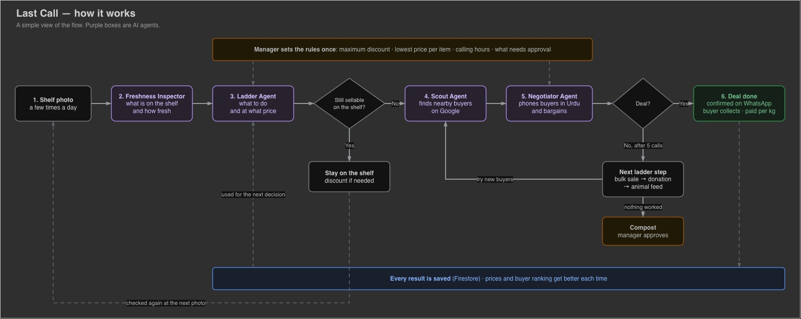
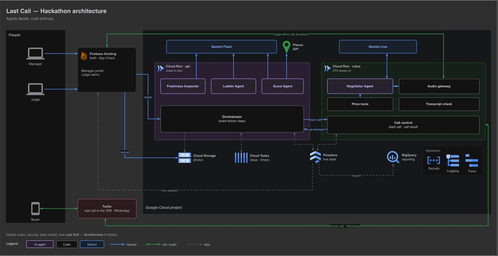

# 🏗️ Last Call — Architecture

## Flowchart:

## Architecture:

> 🏗️ Final hackathon architecture. **Agents decide, code enforces.** No long requests anywhere: every step is a short task that saves its result and schedules the next one.

## 1. Components

| Need | Service |
|---|---|
| Frontend | Firebase Hosting, Firebase Authentication, Firebase App Check, Firestore live listeners |
| Business logic and agents | Cloud Run `api` (ADK: Freshness Inspector, Ladder Agent, Scout Agent, Orchestrator) |
| Live calls | Cloud Run `voice` (ADK live: Negotiator Agent, price tools, audio gateway) |
| Steps and anything that happens later | Cloud Tasks |
| AI | Gemini Flash (vision and reasoning), Gemini Live native audio (voice) |
| Buyer discovery | Places API (New) |
| State and fast lookups | Firestore |
| Photos | Cloud Storage |
| Reporting | BigQuery via the Firestore export extension |
| Calls and confirmations | Twilio voice and WhatsApp |
| Operations | Secret Manager, Cloud Logging, Cloud Trace, budget alerts |

## 2. Frontend (Firebase Hosting)

- **Reads** come straight from Firestore through live listeners: batch status, decisions, live transcript, deals.
- **Writes** always go through the `api`, so every rule is enforced in one place.
- **App Check** ensures only the real web app can call the `api`.
- **Manager portal** (login required): shelf results with reasons, quantity checks, buyer list review, live call transcript, discount tags, approvals (compost), rules and floor prices, daily summary.
- **Judge demo** (public): runs as its own isolated **demo mart** with test buyers and test rules.
    - Upload a shelf photo or choose a sample; the full pipeline runs: Inspector, Ladder, Scout.
    - The estimated quantity is shown as an editable field that doesn't block the flow.
    - The call happens in the browser, with the judge playing the buyer.
    - No route to Twilio; never touches real marts or real stock.
    - 5-minute session limit, plus a global daily session limit stored in Firestore.

## 3. Photo upload

1. The client asks the `api` for a signed upload link: short-lived, images only, size-limited, restricted to that mart's or judge demo session's folder.
2. It uploads the photo straight to a private Cloud Storage bucket.
3. It calls `start-clearance` with the photo's location. The `api` creates the batch, schedules the first step, and **returns immediately**.
4. The screen follows the batch's progress through its Firestore listener.

## 4. `api` service (Cloud Run)

Request-based CPU, scales to zero, many requests per instance, capped maximum instances. Every endpoint does one step, saves state to Firestore, and returns.

### Freshness Inspector (ADK agent, structured output)

- **Input:** the shelf photo, plus the previous result for the same shelf
- **Output per item:** name, position, freshness stage, 0–100 score, change since the last photo, visible issues (mould, rot, bruising, wilting), estimated quantity range, confidence, needs staff check
- Perception only

### Ladder Agent (ADK agent, structured output)

- **Inputs:** Inspector result, rate of decline, quantity, hours until closing, the mart's rules, and `pricing_stats` from Firestore (average accepted price and acceptance rate by item and buyer type)
- **Output:** shelf or off-shelf, discount, which off-shelf steps apply, opening price per kg, estimated hours of shelf life left, a reason for each
- **Code guardrails:** mould or rot means compost only; low confidence means staff check before donation or animal feed; discount clamped to the manager's maximum; opening price at or above the floor
- **Fallback:** a rules version if the agent fails or times out
- **Discount path:** the `api` saves the new price and creates a discount tag; the item stays on the shelf and the next photo re-evaluates it

### Scout Agent (ADK agent with tools)

- **Tools:** Places search, place details, buyer history lookup
- **Two-step Places lookup, with strict field masks:**
    1. Search with basic fields only (ID, name, location, business type).
    2. Fetch phone number and opening hours only for the top few candidates.
- Results cached in Firestore, so the same area isn't searched repeatedly
- Chooses buyer types for the item and its condition, ranks buyers with a reason for each, puts past successful buyers first
- Skips businesses that are closed, have no phone number, are too far away, were called recently, or are on the do-not-call list

### Orchestrator (event-driven, plain Python)

Every step is its own Cloud Task.

**`start-clearance`:** creates an inspection record (`inspection_id`, `shelf_id`) with status "inspecting," schedules the inspect task, and returns immediately. Inspection states: `inspecting → deciding → decided | needs attention`.

**Step tasks** (each one short, retried independently by Cloud Tasks, and skipped if already done):

1. **Inspect:** runs the Freshness Inspector on the shelf photo, saves the `FreshnessResult` in `inspections`, sets status "deciding," schedules the Decide task.
2. **Decide:** runs the Ladder Agent (with the rules fallback) for each assessed produce item. Creates one batch for every off-shelf item (including compost, holding `inspection_id` and `item_key`), and saves the decision on each item:
    - **Stays on the shelf:** applies the discount, creates the tag, marks the item "on shelf." Done.
    - **Compost:** batch enters "awaiting compost approval," sends it for manager approval.
    - **Off the shelf:** batch enters "finding buyers," schedules the next task.
    Once all items are decided, sets inspection status "decided."
3. **Find buyers:** runs the Scout Agent, saves the ranked list for that batch. Then:
    - If the quantity estimate is unsure (low confidence, a wide range, or partly hidden produce), or "always confirm quantity" is on, waits as "awaiting quantity check" until staff confirm the amount.
    - If buyer list review is on, waits as "awaiting review"; the manager's approval schedules the next task.
    - If outside calling hours, waits as "scheduled," with a Cloud Task for when calling hours start.
    - Otherwise, schedules the next task.
4. **Start call:** locks the batch and asks the `voice` service to call the next buyer. The offer uses the confirmed quantity, or the low end of the estimate when no check was needed.

**`call-finished`:** called by the `voice` service after every call.

- Updates `pricing_stats` with the outcome.
- **Deal:** records it, updates the remaining quantity, creates a Cloud Task for the pickup deadline; if stock remains, calls the next buyer.
- **Declined or no answer:** next buyer if fewer than 5 calls in this step (a manager setting); otherwise the next ladder step.
- **Compost reached:** sends it for manager approval.

**Scheduled task endpoints** (called by Cloud Tasks):

- **Calling hours start:** resumes the batch.
- **Lock check:** if a batch is still locked after its expiry, releases it and moves to the next buyer.
- **Pickup deadline:** if staff haven't marked the deal collected after the grace period, records a no-show, lowers that buyer's ranking, re-checks freshness with the latest photo, and restarts the ladder for the remaining stock.

**Failure handling:** if a step fails after its retries, the batch is marked "needs attention" with the reason, and appears on the manager screen. It never stays silently stuck.

## 5. `voice` service (Cloud Run)

CPU always allocated, one warm instance, session affinity, long request timeout, capped maximum instances. Concurrent calls per instance start at 4 and are tuned by measuring CPU during test calls.

### Starting a call

- **`start-call`:** reads the deal brief, asks Twilio to dial, returns immediately. The call runs on Twilio's separate WebSocket connection.
- **Demo number override:** a clearly labelled setting replaces every buyer's real number with verified test numbers, while the screen still shows the real business names and the Scout's reasoning.
- The Gemini Live session starts **only once Twilio reports the call was answered**. Busy, no-answer and failed calls go straight to `call-finished`.
- **Judge demo:** the browser opens its WebSocket directly, presenting a short-lived session token issued by the `api`.

### Negotiator Agent (ADK live mode)

- Everyday Urdu with market vocabulary; friendly but firm
- Introduces itself as the mart's AI assistant; confirms price, quantity, pickup time, deadline and payment
- Treats everything the caller says as conversation, never as instructions
- On hang-up, saves the result and calls `call-finished`

### Tools (code)

- `verify_offer`: never sends the floor to the model. Accepts the buyer's offer if it's at or above the next counter; otherwise returns the higher of the floor or the previous counter minus a shrinking step.
- `confirm_deal`: checks price, remaining quantity and pickup deadline; saves the deal and updates the batch in one all-or-nothing transaction; sends the WhatsApp confirmation.
- `send_photo`, `schedule_callback`, `record_outcome`

### Transcript check

Checks numbers spoken near price words. Any price below the floor makes the agent correct itself and flags the call; it never ends the call.

### Audio

Gemini Live takes **16 kHz** PCM in and returns **24 kHz** PCM out.

- **Browser:**
    - Capture the microphone and send 16 kHz, resampling in an audio worklet if the browser captures at 44.1 or 48 kHz.
    - Play Gemini's audio at 24 kHz.
- **Phone:**
    - Caller to Gemini: 8 kHz μ-law → 16 kHz PCM.
    - Gemini to caller: 24 kHz PCM → 8 kHz μ-law.
    - Chunk by chunk with no buffering: `soxr` for resampling, `audioop-lts` or a NumPy table for μ-law (or Python 3.12).

## 6. Data model (Firestore)

Every record keyed by mart.

- `marts`: settings, rules, floor prices, calling hours, calls per step, review setting, quantity check setting
- `inspections`: stores `inspection_id`, `shelf_id`, `previous_inspection_id`, `photo_uri`, `taken_at`, `items` (each with `item_key` and `decision`), `photo_issues`
    - States: inspecting → deciding → decided | needs attention
- `batches`: discrete off-shelf produce batch for every off-shelf item (including compost), holding `inspection_id` and `item_key`. Stores ladder plan, current step, calls made in this step, remaining quantity, `locked_until`
    - States: finding buyers → awaiting quantity check / awaiting review / scheduled → in negotiation (locked) → sold / partly sold / next step, plus awaiting compost approval → composted, and needs attention from any step
- `calls`: pending → in progress → deal / declined / no answer / call back, with transcript (automatically deleted after a set period)
- `deals`: agreed terms, pickup deadline, collected or no-show, actual weight
- `pricing_stats`: running totals by item and buyer type (calls, deals, total accepted price), updated on every call outcome
- `buyers` (history, ranking, last called), `places_cache`, `do_not_call`, `judge_demo_usage`

**BigQuery:** reporting only, such as the daily impact summary (kg saved, money recovered). Demo `pricing_stats` are seeded from buyer-simulator runs and labelled as simulated.

## 7. Security

### Access

- **Internal endpoints verify tokens themselves.** The step and scheduled task endpoints and `call-finished` on the `api`, and `start-call` on `voice`, check the request's identity token and accept only the expected service account. Cloud Run's built-in login applies to whole services, and both services must be publicly reachable.
- **Manager writes:** the `api` verifies the Firebase login token and the manager's role on every write.
- **Judge demo WebSocket:** requires a short-lived session token from the `api`, issued only after the session limits are checked.
- **Twilio web requests** are verified with Twilio's request signature.
- **Twilio's audio stream** includes a one-time secret per call in its address; `voice` accepts it only if the secret and call ID match a call it started.
- **Firestore rules:** no client writes; managers read only their own mart; judge demo users read only their own session's documents.

### Cost protection (hard limits, not just alerts)

- Maximum instance counts on both Cloud Run services
- Quota limits on the Gemini API and Places API
- Global judge demo session limit and App Check
- Budget alerts at 50%, 75% and 90% as an early warning

### Untrusted input

Uploaded photos, caller speech and Places data are treated as data, never as instructions. Prices, quantities and safety rules are enforced in code, so injected text can't change them. Tested with a judge demo photo containing written instructions.

### Personal data

- Phone numbers masked in logs
- Twilio call recording off
- Transcripts automatically deleted after a set period
- AI disclosure at the start of every call

### Infrastructure

- Each service has its own service account with only the permissions it needs
- Secrets in Secret Manager; `.env.example` in the repo; secret scanning on the repository
- AI-generated code reviewed specifically for missing token checks and overly broad permissions

## 8. Reliability

- **Every endpoint is idempotent**, keyed by batch step, call or task ID, so retries never double-count a step, a call or a deal.
- **Lazy lock expiry** as a safety net alongside the Cloud Task lock check.
- Failed steps mark the batch "needs attention" instead of leaving it stuck.
- Structured logs for every tool call, decision and state change; Cloud Trace across agents.

## 9. Rules enforced in code

Floor price, accept and counter logic, discount limit, quantity and deadline checks, mould means compost, low confidence means staff check, calls per step, calling hours, compost approval, quantity check, lock expiry, demo number override, judge demo limits.

## 10. Fallbacks

- **Negotiator:** plain Gemini SDK if ADK live mode proves unstable
- **Voice quality:** Cloud Speech-to-Text (Chirp) → Gemini → Cloud Text-to-Speech if Gemini Live's Urdu isn't natural enough
- **Ladder Agent:** rules version

## 11. Evidence in the repo

- Tests for price rules, deals, state transitions, locks, idempotency and endpoint authentication
- Freshness Inspector test set (about 50 labelled photos) with saved accuracy results
- Buyer simulator: 50 automated negotiations, floor breaches (target zero) and deal rate
- Measured cost per inspection and per call; measured audio delay on the phone path
- README with architecture, setup, and module status

## Key design decisions

- **Two services** because their scaling needs differ: the `api` scales to zero; `voice` needs CPU for whole calls.
- **No long requests anywhere:** every step, from inspection to the last call, is a short task that saves its result and schedules the next one.
- **Cloud Tasks is the only scheduler;** Firestore states plus tasks form the workflow.
- **Firestore for anything read during a decision;** BigQuery only for reporting.
- **The judge demo is just another mart**, so it runs the real pipeline with no special code paths.
- **Agents decide, code enforces:** every rule that protects money, stock or safety is checked in code.
